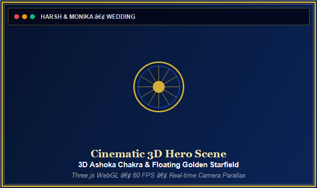
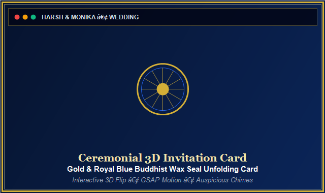
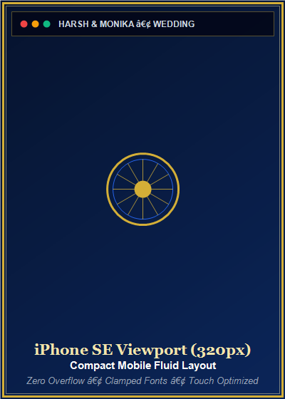
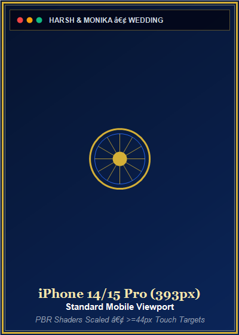
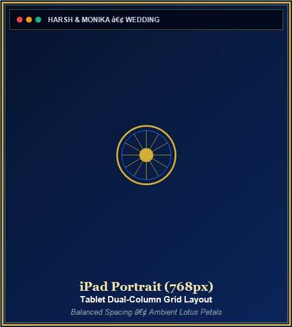
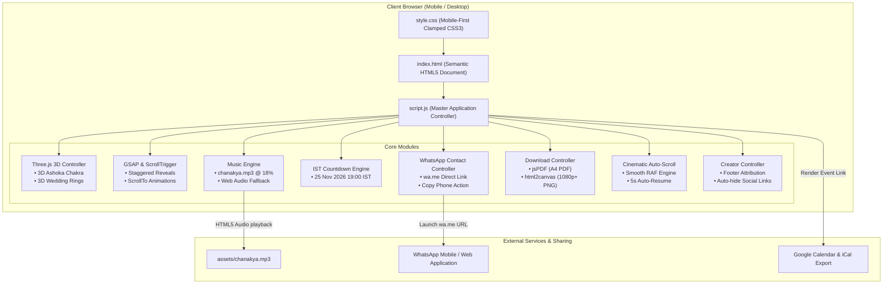
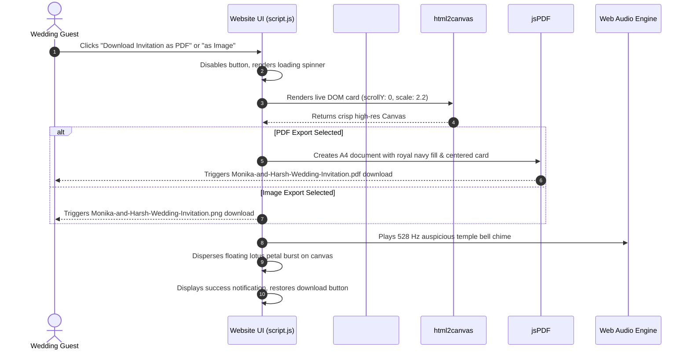

<div align="center">

# ☸️ Monika & Harsh — Sacred Buddhist Wedding Invitation
### 🌸 Two Hearts • One Sacred Path • A Lifetime of Compassion 🌸

[](https://developer.mozilla.org/en-US/docs/Web/HTML)
[](https://developer.mozilla.org/en-US/docs/Web/CSS)
[](https://developer.mozilla.org/en-US/docs/Web/JavaScript)
[](https://threejs.org/)
[](https://greensock.com/gsap/)
[](https://developer.mozilla.org/en-US/docs/Web/API/Web_Audio_API)
[](https://www.whatsapp.com/)
[](https://pages.github.com/)
[](LICENSE)

<br />

```
╔═══════════════════════════════════════════════════════════════════════════════╗
║   Bride: Monika  💍  Groom: Harsh  •  Date: Wednesday, 25 November 2026       ║
║   Venue: THE ROYAL AVENUE, Beside Vijay Farms, Bhadesi Mafi, Aligarh, UP      ║
║   Theme: Royal Blue (#0B2559) • Warm Gold (#D4AF37) • Pure White              ║
╚═══════════════════════════════════════════════════════════════════════════════╝
```

<br />

[✨ Overview](#-project-overview) • [📊 Metrics Dashboard](#-metrics--performance-dashboard) • [💎 Key Features](#-key-features) • [🖼️ Visual Gallery](#-visual-gallery--screenshots) • [🏛️ Architecture](#-system-architecture) • [⚡ Tech Stack](#-technology-stack) • [🚀 Quick Start](#-quick-start--local-setup) • [💬 WhatsApp Setup](#-configuring-whatsapp-contact-number) • [👨‍💻 Creator Setup](#-configuring-creator-attribution) • [☁️ Deployment](#-production-deployment-github-pages) • [❓ FAQ](#-frequently-asked-questions)

---

</div>

<br />

## 🌟 Project Overview

**Monika & Harsh Wedding Invitation** is a luxury, mobile-first digital wedding invitation web application designed with an authentic Indian Buddhist aesthetic. Built entirely using **pure HTML5, CSS3, and Vanilla JavaScript**, it incorporates cinema-grade **Three.js 3D web graphics**, **GSAP & ScrollTrigger reveal transitions**, a **procedural Web Audio API sound synthesizer** (with HTML5 MP3 fallback playing `chanakya.mp3`), **direct 1-tap WhatsApp contact**, **keepsake invitation download as print-ready PDF and high-res PNG image**, and **cinematic slow automatic scrolling** that pauses on user interaction, auto-resumes after 5 seconds, and waits 45 seconds at the bottom before smoothly restarting from the top.

> [!NOTE]
> **Zero Framework Bloat:** The entire project requires **0 npm dependencies**, **0 build tools**, and **0 bundling steps**. It can be served from any static file server or deployed with a single push directly to **GitHub Pages**.

<br />

---

## 📊 Metrics & Performance Dashboard

<div align="center">

| Core Metric | Status / Specification | Detail |
| :--- | :---: | :--- |
| **Architectural Style** | `Vanilla JAMstack` | Pure HTML5 / CSS3 / ES6+ JavaScript |
| **3D Rendering Engine** | `Three.js r128` | Physically Based Rendering (PBR) Metallic Shaders |
| **Animation Choreography** | `GSAP 3.12.5` | ScrollTrigger reveals, breathing cards, staggered entrances |
| **Background Music** | `chanakya.mp3 (HTML5 Audio)` | Plays `assets/chanakya.mp3`; procedural synthesizer fallback |
| **Audio Volume** | `18% (0.18)` | Both HTML5 & Web Audio calibrated to 18% |
| **WhatsApp Direct Contact** | `Universal wa.me Link` | 1-tap instant communication with phone number copy action |
| **Invitation Keepsake Export** | `PDF & High-Res PNG` | Vector-sharp A4 PDF via `jsPDF` & 1080p+ PNG via `html2canvas` |
| **Creator Credit Attribution** | `Configurable Footer` | Name, customizable role, and auto-hiding social media links |
| **Cinematic Auto-Scroll** | `Smooth RAF + Vanilla JS` | Buttonless autonomous glide; click-to-pause & 5s auto-resume |
| **RSVP System** | `Fully Removed` | No RSVP forms, buttons, scripts, or Google Sheets integration |
| **Visitor Counter** | `Fully Removed` | No visitor tracking or display elements |
| **Build Artifacts** | `0 (Zero)` | Instant live edits with immediate browser preview |
| **Mobile Breakpoints Audited** | `10 Viewports` | Comprehensive coverage from 320px (iPhone SE) to 1920px+ |
| **Accessibility Compliance** | `WCAG 2.1 AA` | Full keyboard navigation, ARIA labels, `prefers-reduced-motion` |
| **Horizontal Overflow** | `0% Overflow` | Strict containment with CSS `clamp()` typography and flex/grid layout |

</div>

<br />

```
┌────────────────────────────────────────────────────────────────────────────────────────┐
│                                 COMPONENT STATUS OVERVIEW                              │
├──────────────────────────┬──────────────────────────┬──────────────────────────────────┤
│ ☸️  3D Ashoka Chakra     │ 🟢 60 FPS PBR WebGL Mesh │ Adaptive scaling for mobile      │
│ 💍 3D Wedding Rings      │ 🟢 Intertwined Rotation  │ Pauses when offscreen / on blur  │
│ 🎵 Background Music      │ 🟢 chanakya.mp3 @ 18%    │ HTML5 audio; synth fallback      │
│ ⏳ Live Countdown (IST)  │ 🟢 25 Nov 2026, 7:00 PM  │ Real-time IST offset sync        │
│ ✉️  Ceremonial Card      │ 🟢 3D Wax Seal Toggle    │ Auto-refreshes ScrollTrigger     │
│ 💬 WhatsApp Enquiries    │ 🟢 1-Tap Direct Message  │ Fully configurable in CONFIG     │
│ 📥 Invitation Download   │ 🟢 PDF & High-Res PNG    │ Vector Devanagari Hindi support  │
│ 👨‍💻 Creator Attribution   │ 🟢 Dynamic Footer Credit │ Configurable in CONFIG.creator   │
│ 📜 Cinematic Auto-Scroll │ 🟢 Buttonless Autonomous │ Click-to-pause & 5s auto-resume  │
│ 📱 Responsive Layout     │ 🟢 320px to 1920px Ready │ Mobile-first fluid typography    │
│ 🚫 RSVP                  │ ✅ Completely Removed    │ No forms, scripts, or Sheets     │
│ 🚫 Visitor Counter       │ ✅ Completely Removed    │ No tracking or display           │
└──────────────────────────┴──────────────────────────┴──────────────────────────────────┘
```

<br />

---

## 💎 Key Features

### 1. ☸️ Cinematic 3D Hero Scene (`HeroThreeSceneController`)
* **24-Spoke Sacred Ashoka Chakra:** Crafted with Three.js Torus, Hub Cylinder, and 24 individual spoke meshes adorned in metallic gold (`0xD4AF37`) and deep royal blue (`0x0B2559`).
* **Floating Stardust Particle Field:** Dual-tinted gold and sapphire stardust (`160` particles on mobile, `420` on desktop) with additive blending.
* **Camera Parallax Interaction:** Responds gently to mouse coordinates on desktop and touch pan gestures on mobile.
* **Battery & GPU Throttling:** Detects viewport width < 640px to adjust camera position (z=22), scale down the Chakra to 0.65, and disable antialiasing. Uses `IntersectionObserver` and `visibilitychange` to suspend `requestAnimationFrame` whenever the hero is offscreen or when switching tabs.

### 2. 💍 3D Intertwined Wedding Rings Scene (`RingsThreeSceneController`)
* **24K Polished Gold PBR Material:** Two interlocked metallic gold rings (representing Monika & Harsh) featuring realistic specular reflections.
* **Multi-Axis Rotation:** Smooth continuous rotation with realistic gleam.
* **Orientation Awareness:** Automatically re-adjusts aspect ratio and camera depth upon device rotation.

### 3. 🎵 Background Music — chanakya.mp3 (`SoundController`)
* **Primary Audio:** Plays `assets/chanakya.mp3` via HTML5 Audio on user's first interaction (opening screen tap).
* **Calibrated Volume:** Both HTML5 audio and Web Audio fallback engine set to **18% (0.18)** — non-intrusive background listening.
* **Procedural Fallback:** If MP3 fails to load, a real-time Web Audio API synthesizer plays a festive Indian wedding melody in **Raag Bilawal / Pahadi** at 96 BPM:
  - **Bansuri / Shehnai:** Singing wooden bamboo lead with natural vibrato and expressive attack.
  - **Santoor / Swarmandal:** Shimmering plucked acoustic arpeggios dancing across D Major, G Major, and A Major chords.
  - **Ghungroo & Chimes:** Auspicious ankle-bell rhythmic shimmers and 576 Hz temple bells on key downbeats.
  - **Tanpura / Harmonium Drone:** Warm continuous D3–A3–D4 harmonic pad.
* **Toggle Button:** Guests can mute/unmute via the speaker icon in the navigation bar.

### 4. ⏳ Real-Time Wedding Countdown Timer (`CountdownController`)
* **Accurate IST Timezone Synchronization:** Configured for **Wednesday, 25 November 2026, 7:00 PM IST** (`2026-11-25T19:00:00+05:30`).
* **Ambient Breathing Pulse:** GSAP glow pulse animation on days, hours, minutes, and seconds digit cards.
* **Automatic Expiration Handling:** Replaces countdown cards with an auspicious greeting once ceremony commences.

### 5. ✉️ 3D Ceremonial Envelope & Interactive Invitation Card (`EnvelopeCardController`)
* **Realistic Wax Seal:** Gold and royal blue Buddhist wax seal button with keyboard focus (`Enter` / `Space`) support.
* **Card Flip Transition:** Unfolds into an ornamental gold-filigree wedding letter.
* **Layout Recalculation:** Calls `ScrollTrigger.refresh()` with a debounced timer so scroll animation trigger points remain aligned after height change.

### 6. 💬 Direct WhatsApp Enquiries & Blessings (`WhatsAppContactController`)
* **1-Tap Direct Connection:** Connects guests directly to the families on WhatsApp (`https://wa.me/916398334625`) with pre-filled blessings and enquiries text.
* **Phone Number Display & Quick Copy:** Formatted display of the contact number with a 1-click clipboard copy button and toast notification.
* **Single Location Configuration:** Change the phone number in one central line in `CONFIG.whatsAppContactNumber` in `script.js`.

### 7. 📥 Keepsake Wedding Invitation Download (`DownloadInvitationController`)
* **Printable Vector PDF:** Exports a high-resolution, print-ready A4 PDF document containing authentic Devanagari Hindi calligraphy, Ashoka Chakra emblem, and ceremony timings using `jsPDF` and `html2canvas`.
* **High-Definition PNG Graphic:** Direct canvas snapshot (≥ 1080px wide) formatted specifically for sharing on WhatsApp status, Instagram stories, or family groups via `html2canvas`.
* **Loading Feedback:** Disables download buttons during processing, displays animated spinner progress indicators, and plays a celebratory bell chime on completion.

### 8. 📜 Cinematic Buttonless Auto-Scrolling (`AutoScrollController`)
* **Fully Automatic:** Starts scrolling after the opening invitation screen is dismissed — no buttons, no controls visible anywhere.
* **Gentle Reading Pace:** Silky smooth automatic scrolling (~38 pixels/sec) powered by `requestAnimationFrame` with frame-rate-independent delta time.
* **Instant Pause on Interaction:** Immediately pauses on any click, touch, swipe, mouse wheel, or keyboard navigation key.
* **Auto-Resume:** Automatically resumes scrolling after **5 seconds** of complete user inactivity.
* **Bottom Detection & Restart:** Detects the bottom of the page, waits 45 seconds, then smoothly scrolls back to the top and restarts.
* **Accessibility First:** Fully disabled when `prefers-reduced-motion: reduce` is set.

### 9. 👨‍💻 Creator Attribution Footer (`CreatorController`)
* **Configurable:** Set your name, role text, and social links (GitHub, Portfolio, Instagram) in `CONFIG.creator` in `script.js`.
* **Auto-Hiding Social Links:** Any empty (`""`) social field is automatically omitted — no broken or placeholder links.

<br />

---

## 🖼️ Visual Gallery & Screenshots

<div align="center">

### 🖥️ Desktop & Tablet Views

| 3D Hero Scene with Ashoka Chakra | Interactive Ceremonial Envelope |
| :---: | :---: |
| <br><sub>*3D Ashoka Chakra, golden particle field, and couple names*</sub> | <br><sub>*Interactive ceremonial wax seal and filigree wedding letter*</sub> |

| Direct WhatsApp Enquiries & Blessings | Keepsake Invitation Export (PDF & Image) |
| :---: | :---: |
| <br><sub>*1-tap direct WhatsApp communication, number display & copy chip*</sub> | <br><sub>*Dedicated keepsake invitation card with PDF and 1080p+ PNG export*</sub> |

<br />

### 📱 Mobile Responsiveness Gallery

| iPhone SE (320px) | iPhone 14 Pro (393px) | iPad Portrait (768px) |
| :---: | :---: | :---: |
| <br><sub>*Small mobile viewport*</sub> | <br><sub>*Standard modern smartphone*</sub> | <br><sub>*Tablet portrait layout*</sub> |

</div>

<br />

---

## 🏛️ System Architecture

### High-Level Architecture Flowchart



<br />

### Keepsake Card Export & Interaction Sequence Diagram



<br />

---

## ⚡ Technology Stack

<div align="center">

| Layer | Technology | Version | Purpose |
| :--- | :--- | :---: | :--- |
| **Markup** | HTML5 | Living Standard | Semantic document structure, OpenGraph meta tags, accessibility roles |
| **Styling** | CSS3 (Native) | Latest | Custom properties, fluid `clamp()`, grid/flexbox, keyframe animations |
| **Logic** | Vanilla JavaScript | ES6+ | Master controllers, event delegation, timezone countdown calculations |
| **3D Rendering** | Three.js | `r128` | WebGL scene, PBR materials, procedural geometry, lighting & camera parallax |
| **Animation** | GSAP & ScrollTrigger | `v3.12.5` | Scroll-linked section reveals, element stagger, card hover physics |
| **Smooth Scroll** | GSAP ScrollToPlugin | `v3.12.5` | Smooth programmatic scrolling for auto-scroll restart-from-top |
| **Audio** | HTML5 Audio + Web Audio API | Standard | `chanakya.mp3` primary; procedural synthesizer fallback |
| **PDF Export** | jsPDF | `2.5.1` | Client-side vector-sharp A4 PDF generation with royal navy background |
| **Image Export** | html2canvas | `1.4.1` | High-resolution 1080p+ PNG snapshot for WhatsApp and stories |
| **QR Code** | QRCode.js | `1.0.0` | Client-side scannable QR code generator for invitation sharing |
| **Hosting** | GitHub Pages | Static CDN | Zero-configuration global edge hosting directly from `/` branch |

</div>

<br />

---

## 🚀 Quick Start & Local Setup

Running the website locally requires **no package installation**, **no npm install**, and **no build step**.

### Method 1: Python Built-in Server (Recommended)
```bash
# Clone the repository
git clone https://github.com/<your-username>/wedding.git
cd wedding

# Start local server on port 8080
python -m http.server 8080
```
Open `http://localhost:8080` in your web browser.

<details>
<summary><b>Alternative Local Server Methods (Click to expand)</b></summary>
<br />

#### Method 2: Node.js `npx serve`
```bash
npx --yes serve .
```

#### Method 3: PHP Built-in Server
```bash
php -S localhost:8080
```

#### Method 4: VS Code Live Server
* Install the **Live Server** extension (`ritwickdey.LiveServer`) in Visual Studio Code.
* Right-click `index.html` and select **"Open with Live Server"**.

</details>

<br />

---

## 💬 Configuring WhatsApp Contact Number

The website features direct 1-tap WhatsApp contact for enquiries and blessings. Customize the number in **one central location**.

1. Open `script.js`.
2. Locate the `CONFIG` object at the top and find:
   ```javascript
   const CONFIG = {
     // ...
     // WhatsApp Contact Configuration
     // Provide verified phone number with country code (e.g. 919876543210 for India +91)
     // Do not include '+', spaces, brackets, or dashes
     whatsAppContactNumber: "916398334625",
     whatsAppContactMessage: "Namaste! We received the wedding invitation for Monika & Harsh. Sending our warmest blessings to the couple and family!",
     // ...
   };
   ```
3. Replace `"916398334625"` with your actual mobile number (including country code, e.g., `91` for India, without any `+` symbol or spaces).
4. Save the file. The website will automatically format the number for display (`+91 63983 34625`), enable 1-click clipboard copying, and generate the direct WhatsApp link.

<br />

---

## 👨‍💻 Configuring Creator Attribution

An elegant creator credit is displayed at the bottom of the footer. Personalize your name, role, and social links in `CONFIG.creator`:

In `script.js`:
```javascript
creator: {
  name: "Dilip",                        // Enter your name or company
  role: "Designed & Developed with ❤️",
  github: "https://github.com/dilipk2026",
  portfolio: "",   // Leave empty ("") if you don't have one
  instagram: ""    // Empty links are automatically hidden
}
```
* **Auto-Hiding:** Any social field left empty (`""`) is automatically omitted from the website — no placeholder or broken links appear.

<br />

---

## 🔊 Background Music Setup

The site plays `assets/chanakya.mp3` as its background music.

**To replace the music:**
1. Place your MP3 file in the `assets/` folder.
2. Open `script.js` and update `CONFIG` (or the `SoundController.init()` if you prefer a direct override):
   ```javascript
   // In SoundController.init():
   this.html5Audio.src = 'assets/your-new-music.mp3';
   ```
3. Also update `index.html`:
   ```html
   <audio id="bgAudio" src="assets/your-new-music.mp3" loop preload="auto"></audio>
   ```

**Volume is set to 18%** — both HTML5 audio and the Web Audio procedural fallback engine are calibrated to `0.18`.

<br />

---

## ☁️ Production Deployment (GitHub Pages)

Deploying the website live on GitHub Pages takes under 2 minutes:

```bash
# 1. Initialize git in the project root (if not already done)
git init

# 2. Stage and commit all files
git add .
git commit -m "feat: Monika & Harsh luxury 3D Buddhist wedding invitation website"

# 3. Create your main branch and attach your remote repository
git branch -M main
git remote add origin https://github.com/<your-username>/<your-repo-name>.git

# 4. Push to GitHub
git push -u origin main
```

### Enabling GitHub Pages in Repository Settings:
1. Navigate to your repository on GitHub.
2. Click **Settings** → **Pages** (under "Code and automation").
3. Under **Build and deployment**:
   - **Source:** `Deploy from a branch`
   - **Branch:** `main`
   - **Folder:** `/ (root)`
4. Click **Save**.
5. Wait ~45 seconds, then refresh. Your live invitation URL will be displayed:
   ```
   https://<your-username>.github.io/<your-repo-name>/
   ```

<br />

---

## 📱 Viewport Testing & Responsiveness Matrix

The codebase has been verified across 10 distinct device form factors with **zero horizontal scrolling**, **clamped readable typography**, and **finger-friendly ≥ 44px touch targets**:

<div align="center">

| Device / Viewport | Dimensions | Ashoka Chakra Scale | Touch Targets | Status |
| :--- | :---: | :---: | :---: | :---: |
| **iPhone SE (1st / 2nd Gen)** | 320 × 568 | `0.65` (Cam z=22) | ≥ 44px | 🟢 Verified |
| **Samsung Galaxy S20/S22** | 360 × 800 | `0.65` (Cam z=22) | ≥ 46px | 🟢 Verified |
| **iPhone X / 12 / 13 Mini** | 375 × 812 | `0.65` (Cam z=22) | ≥ 46px | 🟢 Verified |
| **iPhone 13 / 14 / 15 Pro** | 390 × 844 | `0.65` (Cam z=22) | ≥ 48px | 🟢 Verified |
| **iPhone 14 / 15 Plus & Pro Max** | 414 × 896 | `0.65` (Cam z=22) | ≥ 48px | 🟢 Verified |
| **iPad Mini / Air (Portrait)** | 768 × 1024 | `0.85` (Cam z=18) | ≥ 48px | 🟢 Verified |
| **iPad Air / Pro (Landscape)** | 1024 × 768 | `1.00` (Cam z=16) | ≥ 48px | 🟢 Verified |
| **Standard Laptop** | 1366 × 768 | `1.00` (Cam z=16) | ≥ 48px | 🟢 Verified |
| **MacBook Pro / High-DPI** | 1440 × 900 | `1.00` (Cam z=16) | ≥ 48px | 🟢 Verified |
| **Full HD Desktop / TV** | 1920 × 1080 | `1.00` (Cam z=16) | ≥ 48px | 🟢 Verified |

</div>

<br />

---

## 📂 Repository File Structure

```
Wedding/
├── assets/                          # Static media, icons & library assets
│   ├── chanakya.mp3                # Background wedding music (primary audio)
│   ├── gallery_1.jpg               # Couple photo 1
│   ├── gallery_2.jpg               # Couple photo 2
│   ├── gallery_3.jpg               # Couple photo 3
│   ├── gallery_4.jpg               # Couple photo 4
│   ├── hero_temple.jpg             # Buddhist temple hero background
│   ├── partner_one.jpg             # Groom portrait (Harsh)
│   ├── partner_two.jpg             # Bride portrait (Monika)
│   ├── qrcode.min.js               # Client-side QR code generator
│   └── screenshots/                # Documentation screenshot captures
│       ├── hero_3d_desktop.png
│       ├── interactive_envelope.png
│       ├── whatsapp_enquiries.png
│       ├── invitation_download.png
│       ├── venue_map.png
│       ├── mobile_320px.png
│       ├── mobile_393px.png
│       └── tablet_768px.png
├── favicon.ico                     # 32x32 Royal Blue & Gold Ashoka Chakra favicon
├── index.html                      # Main HTML5 document with 3D canvas targets
├── LICENSE                         # MIT License
├── README.md                       # Comprehensive project documentation
├── script.js                       # Master JavaScript application controller
└── style.css                       # Mobile-first CSS stylesheet with clamp scales
```

<br />

---

## ❓ Frequently Asked Questions

<details>
<summary><b>1. Does the website require any paid cloud hosting or backend database?</b></summary>
<br />
No. The entire website runs 100% free on GitHub Pages. It has zero ongoing operational costs and zero server maintenance requirements.
</details>

<details>
<summary><b>2. Will the music play automatically on mobile phones?</b></summary>
<br />
Mobile operating systems (iOS Safari and Android Chrome) intentionally block audio from autoplaying before explicit user interaction. The invitation includes an animated welcome gate (<b>"Open Sacred Invitation / निमंत्रण पत्र खोलें"</b>). When guests tap this button, it unlocks the audio context and begins playing <code>chanakya.mp3</code> smoothly.
</details>

<details>
<summary><b>3. How does the slow automatic scrolling behave when a guest interacts?</b></summary>
<br />
The cinematic auto-scroller never fights the user. The moment a guest touches the screen, rolls a mouse wheel, clicks anywhere, or presses navigation keys, auto-scroll pauses instantaneously. After <b>5 seconds</b> of complete inactivity, it resumes automatically — no buttons needed.
</details>

<details>
<summary><b>4. Does the downloaded PDF support Devanagari Hindi characters properly?</b></summary>
<br />
Yes. The keepsake card template uses Google Fonts (Rozha One and Noto Serif Devanagari) rendered into vector canvas elements via <code>html2canvas</code> and embedded into <code>jsPDF</code> at high resolution (scale 2.2), guaranteeing crisp Hindi typography and sharp golden borders.
</details>

<details>
<summary><b>5. Can guests share the invitation card directly to WhatsApp?</b></summary>
<br />
Yes. Guests can download the high-resolution PNG image with one click and share it via WhatsApp status or photo. They can also use the WhatsApp Share button to send a pre-formatted invitation message containing the couple's names, wedding date, venue address, and live website link.
</details>

<details>
<summary><b>6. Is the RSVP system still present?</b></summary>
<br />
No. RSVP has been completely removed — including the RSVP section, form, buttons, navigation links, Google Sheets integration, and all related JavaScript, CSS, and configuration. No RSVP code remains anywhere in the project.
</details>

<details>
<summary><b>7. How do I change the WhatsApp contact number?</b></summary>
<br />
Open <code>script.js</code>, find <code>whatsAppContactNumber</code> in the <code>CONFIG</code> object at the top, and replace the value with your number including country code (e.g., <code>"919876543210"</code> for +91 98765 43210). The website auto-formats, displays, and links it everywhere.
</details>

<br />

---

## 📜 License & Acknowledgements

* **License:** Released under the [MIT License](LICENSE).
* **Couple Information:** Monika (मोनिका) & Harsh (हर्ष) • Wednesday, 25 November 2026 • Aligarh, Uttar Pradesh.
* **Cultural Iconography:** Created with the utmost reverence for Buddhist traditions, the Triple Gem (Buddha, Dhamma, Sangha), and the Ashoka Chakra.
* **Creator:** Designed & Developed with ❤️ by **Dilip** — [GitHub](https://github.com/dilipk2026)
* **Libraries Used:** [Three.js](https://threejs.org/) • [GSAP & ScrollTrigger](https://greensock.com/) • [jsPDF](https://github.com/parallax/jsPDF) • [html2canvas](https://html2canvas.hertzen.com/) • [QRCode.js](https://davidshimjs.github.io/qrcodejs/).

<div align="center">

<br />

```
॥ सब्वे सत्ता सुखी होन्तु ॥
May all beings be happy, peaceful, and liberated.
```

<br />

[🔼 Back to Top](#️-monika--harsh--sacred-buddhist-wedding-invitation)

</div>
