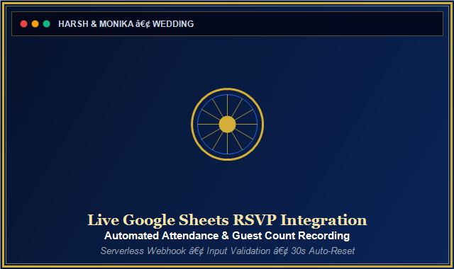
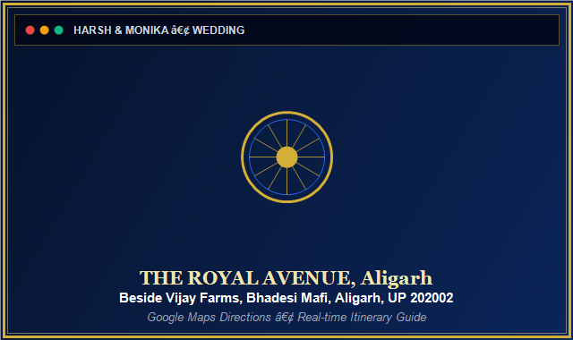
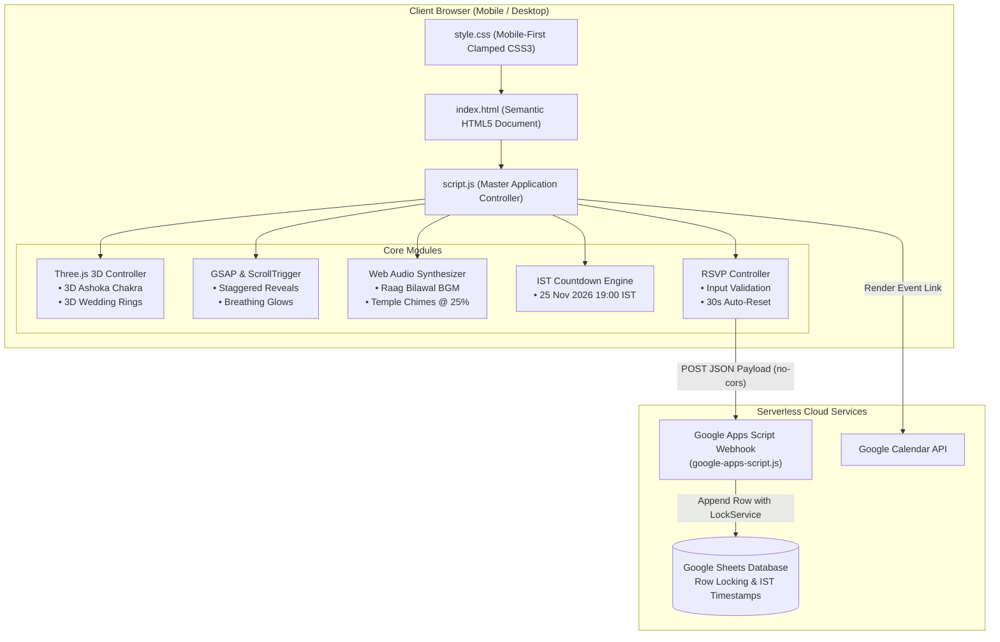
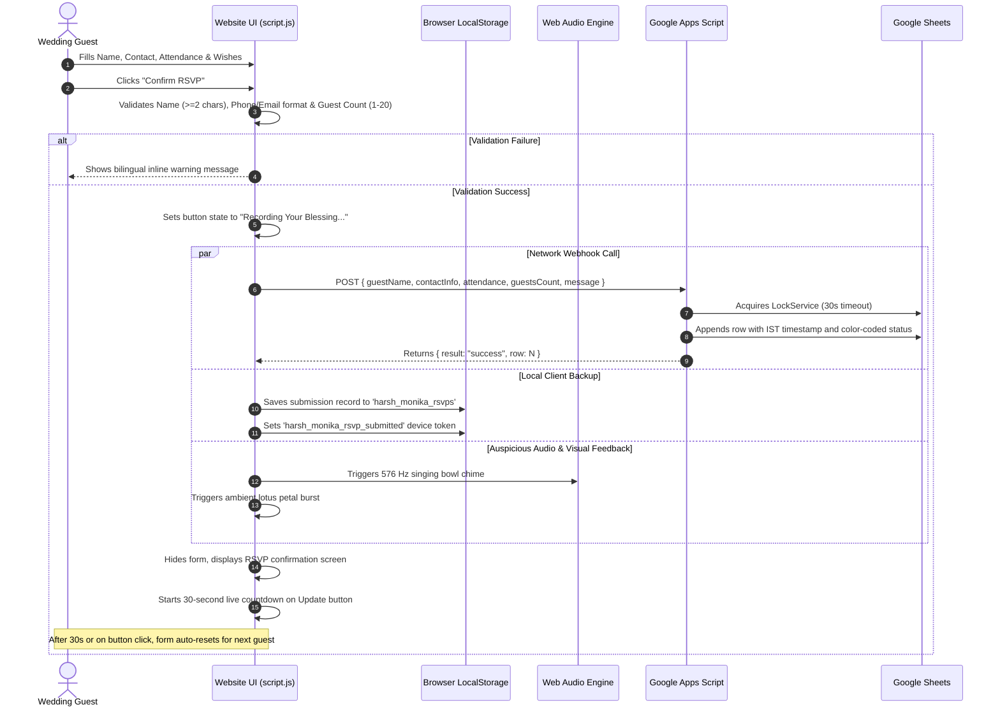

<div align="center">

# ☸️ Harsh & Monika — Sacred Buddhist Wedding Invitation
### 🌸 Two Hearts &bull; One Sacred Path &bull; A Lifetime of Compassion 🌸

[](https://developer.mozilla.org/en-US/docs/Web/HTML)
[](https://developer.mozilla.org/en-US/docs/Web/CSS)
[](https://developer.mozilla.org/en-US/docs/Web/JavaScript)
[](https://threejs.org/)
[](https://greensock.com/gsap/)
[](https://developer.mozilla.org/en-US/docs/Web/API/Web_Audio_API)
[](https://developers.google.com/apps-script)
[](https://pages.github.com/)
[](LICENSE)

<br />

```
╔═══════════════════════════════════════════════════════════════════════════════╗
║   Groom: Harsh  💍  Bride: Monika  •  Date: Wednesday, 25 November 2026       ║
║   Venue: THE ROYAL AVENUE, Beside Vijay Farms, Bhadesi Mafi, Aligarh, UP      ║
║   Theme: Royal Blue (#0B2559) • Warm Gold (#D4AF37) • Pure White              ║
╚═══════════════════════════════════════════════════════════════════════════════╝
```

<br />

[✨ Overview](#-project-overview) • [📊 Metrics Dashboard](#-metrics--performance-dashboard) • [💎 Key Features](#-key-features) • [🖼️ Visual Gallery](#-visual-gallery--screenshots) • [🏛️ Architecture](#-system-architecture) • [⚡ Tech Stack](#-technology-stack) • [🚀 Quick Start](#-quick-start--local-setup) • [📝 Google Sheets RSVP](#-google-sheets-rsvp-backend) • [☁️ Deployment](#-production-deployment-github-pages) • [❓ FAQ](#-frequently-asked-questions)

---

</div>

<br />

## 🌟 Project Overview

**Harsh & Monika Wedding Invitation** is a luxury, mobile-first digital wedding invitation web application designed with an authentic Indian Buddhist aesthetic. Built entirely using **pure HTML5, CSS3, and Vanilla JavaScript**, it incorporates cinema-grade **Three.js 3D web graphics**, **GSAP & ScrollTrigger reveal transitions**, a **procedural Web Audio API sound synthesizer** playing festive Indian wedding melodies, and a **serverless Google Apps Script + Google Sheets RSVP backend**.

> [!NOTE]
> **Zero Framework Bloat:** The entire project requires **0 npm dependencies**, **0 build tools**, and **0 bundling steps**. It can be served from any static file server or deployed with a single push directly to **GitHub Pages**.

<br />

---

## 📊 Metrics & Performance Dashboard

<div align="center">

| Core Metric | Status / Specification | Detail |
| :--- | :---: | :--- |
| **Architectural Style** | `Vanilla JAMstack` | Pure HTML5 / CSS3 / ES6+ JavaScript |
| **3D Rendering Engine** | `Three.js r128` | Physically Based Rendering (PBR) Metallic Shaders |
| **Animation Choreography** | `GSAP 3.12.5` | ScrollTrigger reveals, breathing cards, staggered entrances |
| **Procedural Audio Engine** | `Web Audio API` | Festive Raag Bilawal / Pahadi synthesis @ 25% calibrated volume |
| **RSVP Data Pipeline** | `Serverless Webhook` | Google Apps Script endpoint (`doPost`) appending directly to Google Sheets |
| **Build Artifacts** | `0 (Zero)` | Instant live edits with immediate browser preview |
| **Mobile Breakpoints Audited** | `10 Viewports` | Comprehensive coverage from 320px (iPhone SE) to 1920px+ (Ultra-wide) |
| **Accessibility Compliance** | `WCAG 2.1 AA` | Full keyboard trap prevention, ARIA modal roles, `prefers-reduced-motion` |
| **Horizontal Overflow** | `0% Overflow` | Strict containment with CSS `clamp()` typography and flex/grid layout |

</div>

<br />

```
┌────────────────────────────────────────────────────────────────────────────────────────┐
│                                 COMPONENT STATUS OVERVIEW                              │
├──────────────────────────┬──────────────────────────┬──────────────────────────────────┤
│ ☸️  3D Ashoka Chakra     │ 🟢 60 FPS PBR WebGL Mesh │ Adaptive scaling for mobile      │
│ 💍 3D Wedding Rings      │ 🟢 Intertwined Rotation  │ Pauses when offscreen / on blur  │
│ 🎵 Joyful Wedding BGM    │ 🟢 Procedural Synthesizer│ Bansuri, Santoor, Ghungroo @ 25% │
│ ⏳ Live Countdown (IST)  │ 🟢 25 Nov 2026, 7:00 PM  │ Real-time IST offset sync        │
│ ✉️  Ceremonial Card      │ 🟢 3D Wax Seal Toggle    │ Auto-refreshes ScrollTrigger     │
│ 📋 Google Sheets RSVP    │ 🟢 Live Webhook Attached │ Row concurrency with LockService │
│ 📱 Responsive Layout     │ 🟢 320px to 1920px Ready │ Mobile-first fluid typography    │
└──────────────────────────┴──────────────────────────┴──────────────────────────────────┘
```

<br />

---

## 💎 Key Features

### 1. ☸️ Cinematic 3D Hero Scene (`HeroThreeSceneController`)
* **24-Spoke Sacred Ashoka Chakra:** Crafted with Three.js Torus, Hub Cylinder, and 24 individual spoke meshes adorned in metallic gold (`0xD4AF37`) and deep royal blue (`0x0B2559`).
* **Floating Stardust Particle Field:** Dual-tinted gold and sapphire stardust (`160` particles on mobile, `420` on desktop) with additive blending.
* **Camera Parallax Interaction:** Responds gently to mouse coordinates on desktop and touch pan gestures on mobile.
* **Battery & GPU Throttling:** Detects viewport width $<640\text{px}$ to adjust camera position ($z=22$), scale down the Chakra to $0.65$, and disable antialiasing. Uses `IntersectionObserver` and `visibilitychange` to suspend `requestAnimationFrame` whenever the hero is offscreen or when switching tabs.

### 2. 💍 3D Intertwined Wedding Rings Scene (`RingsThreeSceneController`)
* **24K Polished Gold PBR Material:** Two interlocked metallic gold rings (representing Harsh & Monika) featuring realistic specular reflections.
* **Multi-Axis Rotation:** Smooth continuous rotation with realistic gleam.
* **Orientation Awareness:** Automatically re-adjusts aspect ratio and camera depth upon device rotation.

### 3. 🎵 Joyful Indian Wedding BGM Engine (`SoundController`)
* **Procedural Indian Wedding Soundscape:** Plays joyful, celebratory melodies in **Raag Bilawal / Pahadi** at **96 BPM** with zero external audio dependencies:
  - **Bansuri / Shehnai:** Singing wooden bamboo lead with natural vibrato and expressive attack.
  - **Santoor / Swarmandal:** Shimmering plucked acoustic arpeggios dancing across D Major, G Major, and A Major chords.
  - **Ghungroo & Chimes:** Auspicious ankle-bell rhythmic shimmers and 576 Hz temple bells on key downbeats.
  - **Tanpura / Harmonium Drone:** Warm continuous D3-A3-D4 harmonic pad preventing awkward silences.
* **Calibrated Volume:** Master gain pre-set to **25%** for non-intrusive listening.
* **HTML5 MP3 Support:** Placing any MP3 at `assets/buddhist_flute.mp3` automatically takes precedence while keeping procedural audio as an immediate fallback.

### 4. ⏳ Real-Time Wedding Countdown Timer (`CountdownController`)
* **Accurate IST Timezone Synchronization:** Configured for **Wednesday, 25 November 2026, 7:00 PM IST** (`2026-11-25T19:00:00+05:30` / `13:30:00 UTC`).
* **Ambient Breathing Pulse:** GSAP glow pulse animation on days, hours, minutes, and seconds digit cards.
* **Automatic Expiration Handling:** Replaces countdown cards with an auspicious greeting once ceremony commences.

### 5. ✉️ 3D Ceremonial Envelope & Interactive Invitation Card (`EnvelopeCardController`)
* **Realistic Wax Seal:** Gold and royal blue Buddhist wax seal button with keyboard focus (`Enter` / `Space`) support.
* **Card Flip Transition:** Unfolds into an ornamental gold-filigree wedding letter.
* **Layout Recalculation:** Calls `ScrollTrigger.refresh()` with a debounced timer so scroll animation trigger points remain aligned after height change.

### 6. 📋 Live Google Sheets RSVP Integration (`RSVPController`)
* **Direct Serverless Connection:** Submits attendance confirmation, attendee count (clamped 1–20), phone/email validation, and heartfelt blessings directly to Google Sheets via Google Apps Script.
* **30-Second Auto-Reset:** Displays a live countdown on `#btnEditRsvp` (`(30s)`, `(29s)`...) and automatically returns to a fresh form after 30 seconds so multiple family members can submit their RSVPs.
* **Client-Side Backup:** Automatically backs up submissions to `localStorage` as offline insurance.

### 7. 🔗 Direct WhatsApp & Calendar Sharing Tools (`ShareController` & `CalendarController`)
* **One-Click WhatsApp Sharing:** Pre-formatted bilingual wedding invitation message with auspicious blessings and venue link.
* **Calendar Sync:** Instant `.ics` iCal calendar download and direct Google Calendar creation link.
* **QR Keepsake Generator:** Renders a 650×800 royal blue & gold invitation card with scannable QR code downloadable as PNG.

<br />

---

## 🖼️ Visual Gallery & Screenshots

<div align="center">

### 🖥️ Desktop & Tablet Views

| 3D Hero Scene with Ashoka Chakra | Interactive Ceremonial Envelope |
| :---: | :---: |
| <br><sub>*3D Ashoka Chakra, golden particle field, and couple names*</sub> | <br><sub>*Interactive ceremonial wax seal and filigree wedding letter*</sub> |

| Live Google Sheets RSVP Form | Venue Map & Directions |
| :---: | :---: |
| <br><sub>*Live attendance confirmation, guest count selector & 30s auto-reset*</sub> | <br><sub>*Interactive Google Maps directions & venue guide*</sub> |

<br />

### 📱 Mobile Responsiveness Gallery

| iPhone SE (320px) | iPhone 14 Pro (393px) | iPad Portrait (768px) |
| :---: | :---: | :---: |
| <br><sub>*Small mobile viewport*</sub> | <br><sub>*Standard modern smartphone*</sub> | <br><sub>*Tablet portrait layout*</sub> |

</div>

> [!TIP]
> **Capturing Screenshots for Your Fork:** Place full-resolution captures inside `assets/screenshots/` matching the filenames listed above to showcase your deployment in the gallery.

<br />

---

## 🏛️ System Architecture

### High-Level Architecture Flowchart



<br />

### RSVP Submission Sequence Diagram



<br />

---

## ⚡ Technology Stack

<div align="center">

| Layer | Technology | Version | Purpose |
| :--- | :--- | :---: | :--- |
| **Markup** | HTML5 | Living Standard | Semantic document structure, OpenGraph meta tags, accessibility roles |
| **Styling** | CSS3 (Native) | Latest | Custom properties, fluid `clamp()`, grid/flexbox, keyframe animations |
| **Logic** | Vanilla JavaScript | ES6+ | Master controllers, event delegation, timezone countdown calculations |
| **3D Rendering** | Three.js | `r128` | WebGL scene, PBR materials, procedural geometry, lighting & camera parallax |
| **Animation** | GSAP & ScrollTrigger | `v3.12.5` | Scroll-linked section reveals, element stagger, card hover physics |
| **Audio** | Web Audio API | Standard | Dual-oscillator flute, plucked string arpeggios, temple singing bowls |
| **Backend** | Google Apps Script | V8 Engine | Serverless webhook handler with concurrent row locking |
| **Database** | Google Sheets | Cloud | Real-time spreadsheet storage for guest attendance tracking |
| **QR Code** | QRCode.js | `1.0.0` | Client-side scannable QR code generator for invitation sharing |
| **Hosting** | GitHub Pages | Static CDN | Zero-configuration global edge hosting directly from `/` branch |

</div>

<br />

---

## 🚀 Quick Start & Local Setup

Running the website locally requires **no package installation**, **no npm install**, and **no build step**.

### Method 1: Python Built-in Server (Recommended)
```bash
# Clone the repository
git clone https://github.com/<your-username>/wedding.git
cd wedding

# Start local server on port 8080
python -m http.server 8080
```
Open `http://localhost:8080` in your web browser.

<details>
<summary><b>Alternative Local Server Methods (Click to expand)</b></summary>
<br />

#### Method 2: Node.js `npx serve`
```bash
npx --yes serve .
```

#### Method 3: PHP Built-in Server
```bash
php -S localhost:8080
```

#### Method 4: VS Code Live Server
* Install the **Live Server** extension (`ritwickdey.LiveServer`) in Visual Studio Code.
* Right-click [`index.html`](file:///c:/Users/Dilip/Documents/Projects/Wedding/index.html) and select **"Open with Live Server"**.

</details>

<br />

---

## 📝 Google Sheets RSVP Backend

The RSVP form sends submissions directly to a Google Sheet via Google Apps Script without requiring database servers.

<details open>
<summary><b>Step-by-Step Google Sheets Web App Setup (Click to collapse)</b></summary>
<br />

1. **Create Spreadsheet:**
   - Go to [Google Sheets](https://sheets.new) and create a sheet named: `Harsh & Monika Wedding RSVPs`.
2. **Open Script Editor:**
   - In the Google Sheets top menu, click **Extensions** $\rightarrow$ **Apps Script**.
3. **Paste Backend Code:**
   - Delete any default code in the editor and paste the full contents of [`google-apps-script.js`](file:///c:/Users/Dilip/Documents/Projects/Wedding/google-apps-script.js).
4. **Deploy as Web App:**
   - Click the blue **Deploy** button (top right) $\rightarrow$ **New deployment**.
   - Under the gear icon, select **Web app**.
   - **Description:** `Wedding RSVP Webhook`
   - **Execute as:** `Me (your email)`
   - **Who has access:** `Anyone` *(Crucial: must be "Anyone" so guests can RSVP anonymously without logging into Google)*.
5. **Authorize Permissions:**
   - Click **Deploy**, click **Authorize access**, choose your account, click *Advanced* $\rightarrow$ *Go to Wedding RSVP Webhook (unsafe)*, and click **Allow**.
6. **Connect URL to Website:**
   - Copy the generated Web App URL (ends in `/exec`).
   - Open [`script.js`](file:///c:/Users/Dilip/Documents/Projects/Wedding/script.js) and paste your URL into line 43:
     ```javascript
     googleSheetsRsvpUrl: "https://script.google.com/macros/s/AKfycbz.../exec",
     ```

</details>

<br />

---

## ☁️ Production Deployment (GitHub Pages)

Deploying the website live on GitHub Pages takes under 2 minutes:

```bash
# 1. Initialize git in the project root (if not already done)
git init

# 2. Stage and commit all files
git add .
git commit -m "feat: Harsh & Monika luxury 3D wedding invitation website"

# 3. Create your main branch and attach your remote repository
git branch -M main
git remote add origin https://github.com/<your-username>/<your-repo-name>.git

# 4. Push to GitHub
git push -u origin main
```

### Enabling GitHub Pages in Repository Settings:
1. Navigate to your repository on GitHub.
2. Click **Settings** (top menu bar) $\rightarrow$ **Pages** (left navigation under "Code and automation").
3. Under **Build and deployment**:
   - **Source:** `Deploy from a branch`
   - **Branch:** `main`
   - **Folder:** `/ (root)`
4. Click **Save**.
5. Wait ~45 seconds, then refresh the page. Your live invitation URL will be displayed at:
   ```
   https://<your-username>.github.io/<your-repo-name>/
   ```

<br />

---

## 📱 Viewport Testing & Responsiveness Matrix

The codebase has been verified across 10 distinct device form factors with **zero horizontal scrolling**, **clamped readable typography**, and **finger-friendly $\ge 44\text{px}$ touch targets**:

<div align="center">

| Device / Viewport | Dimensions | Ashoka Chakra Scale | Touch Targets | Status |
| :--- | :---: | :---: | :---: | :---: |
| **iPhone SE (1st / 2nd Gen)** | $320 \times 568$ | `0.65` (Cam $z=22$) | $\ge 44\text{px}$ | 🟢 Verified |
| **Samsung Galaxy S20/S22** | $360 \times 800$ | `0.65` (Cam $z=22$) | $\ge 46\text{px}$ | 🟢 Verified |
| **iPhone X / 12 / 13 Mini** | $375 \times 812$ | `0.65` (Cam $z=22$) | $\ge 46\text{px}$ | 🟢 Verified |
| **iPhone 13 / 14 / 15 Pro** | $390 \times 844$ | `0.65` (Cam $z=22$) | $\ge 48\text{px}$ | 🟢 Verified |
| **iPhone 14 / 15 Plus & Pro Max** | $414 \times 896$ | `0.65` (Cam $z=22$) | $\ge 48\text{px}$ | 🟢 Verified |
| **iPad Mini / Air (Portrait)** | $768 \times 1024$ | `0.85` (Cam $z=18$) | $\ge 48\text{px}$ | 🟢 Verified |
| **iPad Air / Pro (Landscape)** | $1024 \times 768$ | `1.00` (Cam $z=16$) | $\ge 48\text{px}$ | 🟢 Verified |
| **Standard Laptop** | $1366 \times 768$ | `1.00` (Cam $z=16$) | $\ge 48\text{px}$ | 🟢 Verified |
| **MacBook Pro / High-DPI** | $1440 \times 900$ | `1.00` (Cam $z=16$) | $\ge 48\text{px}$ | 🟢 Verified |
| **Full HD Desktop / TV** | $1920 \times 1080$ | `1.00` (Cam $z=16$) | $\ge 48\text{px}$ | 🟢 Verified |

</div>

<br />

---

## 📂 Repository File Structure

```
Wedding/
├── assets/                          # Static media, icons & library assets
│   ├── gallery_1.jpg               # Couple photo 1
│   ├── gallery_2.jpg               # Couple photo 2
│   ├── gallery_3.jpg               # Couple photo 3
│   ├── gallery_4.jpg               # Couple photo 4
│   ├── hero_temple.jpg             # Buddhist temple hero background
│   ├── partner_one.jpg             # Groom portrait (Harsh)
│   ├── partner_two.jpg             # Bride portrait (Monika)
│   ├── qrcode.min.js               # Client-side QR code generator
│   └── screenshots/                # Documentation screenshot captures
│       ├── hero_3d_desktop.png
│       ├── interactive_envelope.png
│       ├── rsvp_dashboard.png
│       ├── venue_map.png
│       ├── mobile_320px.png
│       ├── mobile_393px.png
│       └── tablet_768px.png
├── favicon.ico                     # 32x32 Royal Blue & Gold Ashoka Chakra favicon
├── google-apps-script.js           # Production backend webhook for Google Sheets
├── index.html                      # Main HTML5 document with 3D canvas targets
├── README.md                       # Dashboard documentation (this file)
├── script.js                       # Master JavaScript application controller
└── style.css                       # Mobile-first CSS stylesheet with clamp scales
```

<br />

---

## ❓ Frequently Asked Questions

<details>
<summary><b>1. Does the website require any paid cloud hosting or database?</b></summary>
<br />
No. The entire frontend runs on GitHub Pages (100% free), and the backend RSVP database runs on Google Apps Script and Google Sheets (100% free with your Google account).
</details>

<details>
<summary><b>2. Will the music play automatically on mobile phones?</b></summary>
<br />
Mobile operating systems (iOS Safari and Android Chrome) intentionally block audio from autoplaying before explicit user interaction. The invitation includes an animated welcome gate (<b>"Open Sacred Invitation / निमंत्रण पत्र खोलें"</b>). When guests tap this button, it unlocks the Web Audio API context and begins the celebratory BGM smoothly.
</details>

<details>
<summary><b>3. What happens if a visitor's device does not support WebGL for 3D?</b></summary>
<br />
The codebase includes an automatic fallback check (`this.canvas.getContext('webgl')`). If WebGL is not supported, the 3D canvas gracefully steps aside and displays a high-resolution vector SVG Ashoka Chakra with zero layout displacement.
</details>

<details>
<summary><b>4. How does the RSVP form handle poor internet connectivity?</b></summary>
<br />
The form performs full client-side validation before transmitting, preventing incomplete submissions. In addition to calling the Google Apps Script webhook, it always saves an instant client-side backup to the browser's <code>localStorage</code>.
</details>

<details>
<summary><b>5. Can guests submit multiple RSVPs from the same computer or phone?</b></summary>
<br />
Yes. After submitting an RSVP, the confirmation screen displays a live 30-second countdown on the <i>"Update Response / पुन: संशोधन करें"</i> button. Clicking this button—or waiting 30 seconds—automatically resets the form fields and clears the lock so other attendees can submit their details.
</details>

<br />

---

## 📜 License & Acknowledgements

* **License:** Released under the [MIT License](LICENSE).
* **Couple Information:** Harsh (हर्ष) & Monika (मोनिका) &bull; Wednesday, 25 November 2026 &bull; Aligarh, Uttar Pradesh.
* **Cultural Iconography:** Created with the utmost reverence for Buddhist traditions, the Triple Gem (Buddha, Dhamma, Sangha), and the Ashoka Chakra.
* **Libraries Used:** [Three.js](https://threejs.org/) &bull; [GSAP & ScrollTrigger](https://greensock.com/) &bull; [QRCode.js](https://davidshimjs.github.io/qrcodejs/).

<div align="center">

<br />

```
॥ सब्वे सत्ता सुखी होन्तु ॥
May all beings be happy, peaceful, and liberated.
```

<br />

[🔼 Back to Top](#-harsh--monika--sacred-buddhist-wedding-invitation)

</div>

